# RL based Robotic swarm coordination

A reinforcement learning project for multi-robot coordination, built around a 10-robot swarm that learns to cover a cluttered 50 x 50 grid while avoiding collisions.

Instead of giving every robot a fixed written rule, I trained a shared RL policy that each robot can use locally. The robots begin in a clustered region, spread out across a structured map, avoid obstacles and other robots, and try to maximise explored free space.

## Result summary

The learned controller is evaluated against two baselines: a deterministic **Greedy Coverage Algorithm** and an uncoordinated random walk controller.

| Controller | Final coverage | Collisions | Total reward |
| --- | ---: | ---: | ---: |
| RL swarm | **79.89%** | **0** | **3810.353** |
| Greedy Coverage Algorithm | 64.64% | 0 | 3251.303 |
| Random walk | 11.34% | 211 | 246.955 |

The RL swarm covers 15.25 percentage points more free space than the Greedy Coverage Algorithm while keeping collisions at **0**.

## Visual overview

### Coverage comparison

The coverage curve shows how quickly each controller explores the map during the evaluation rollout. The RL swarm separates from the greedy baseline because it spreads robots more aggressively across different regions instead of repeatedly selecting the same locally attractive areas.

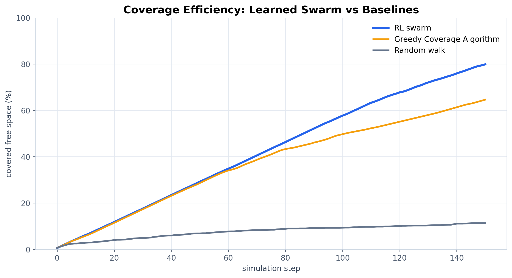

### Final coverage by controller

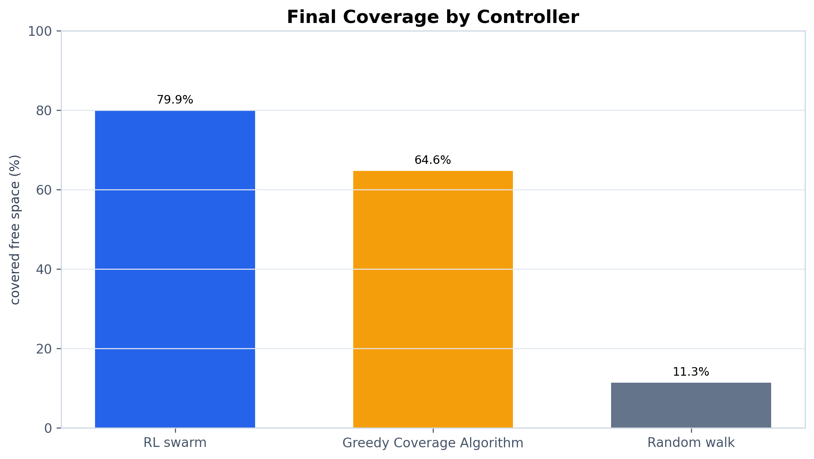

### Collision count by controller

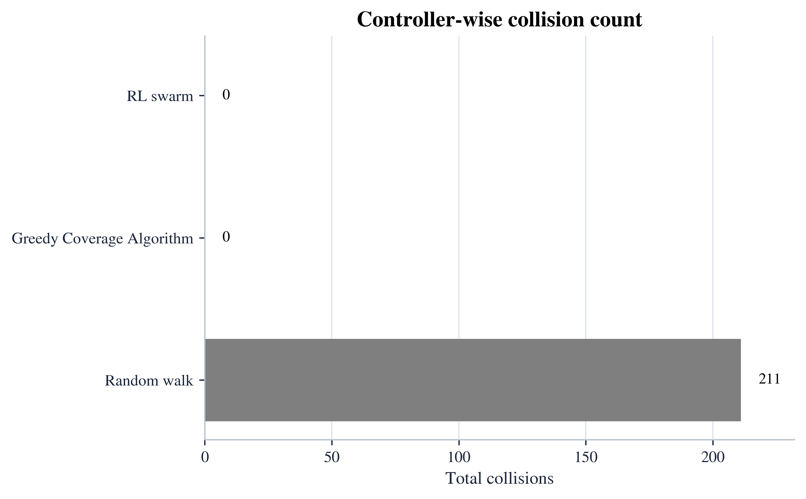

### Learned trajectory map

The trajectory map shows the 10-robot rollout on the 50 x 50 environment. Dark cells are obstacles. Colored paths show how individual robots spread across the map.

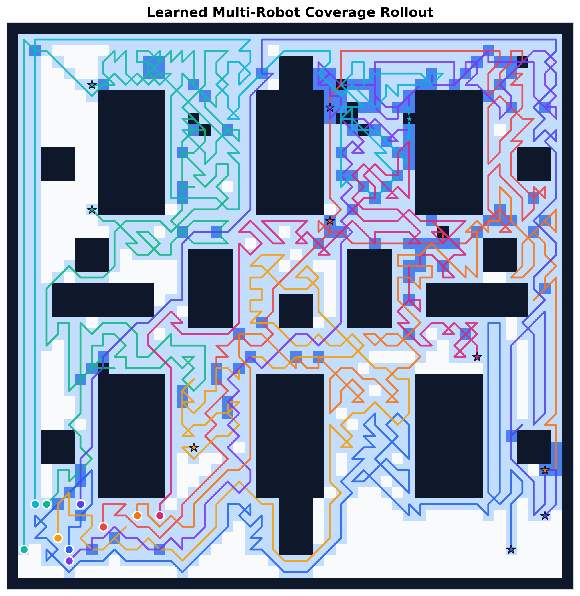

### Learned visitation heatmap

The heatmap shows where the learned policy spends time. It helps reveal whether robots are revisiting the same corridors too often or distributing exploration across the map.

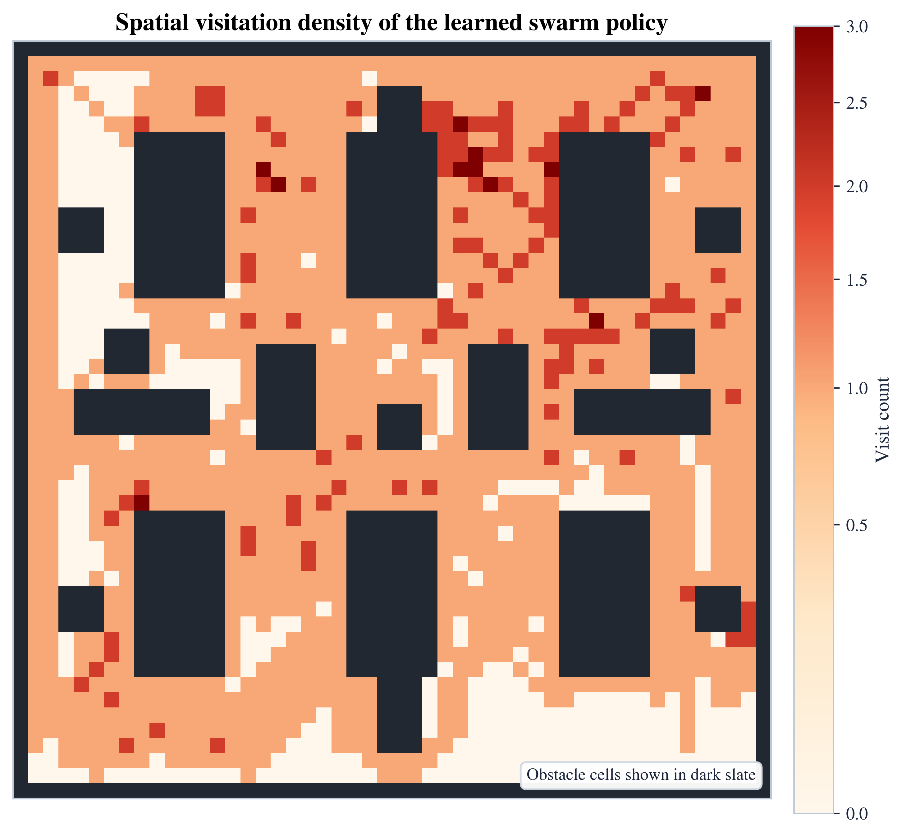

### Robot spacing over time

This plot tracks mean nearest-neighbour spacing. It is a useful sanity check for swarm behavior because a good coverage policy should not keep all robots clustered.

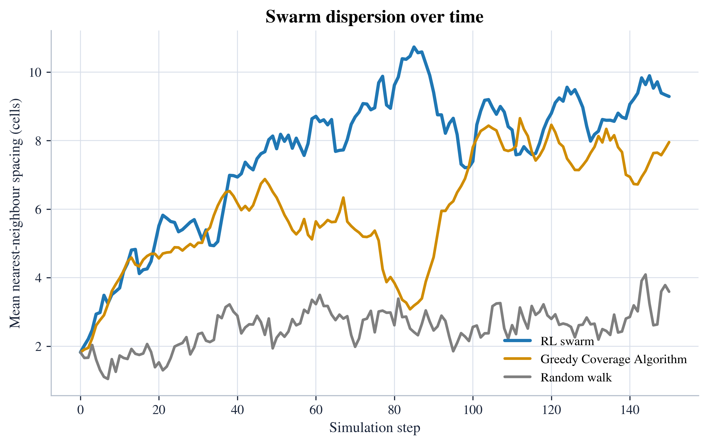

## Rollout snapshots

These snapshots show the learned policy at different points in the rollout. The local trails make it easier to see short-term motion patterns without cluttering the full map.

| Step 0 | Step 45 |
| --- | --- |
| 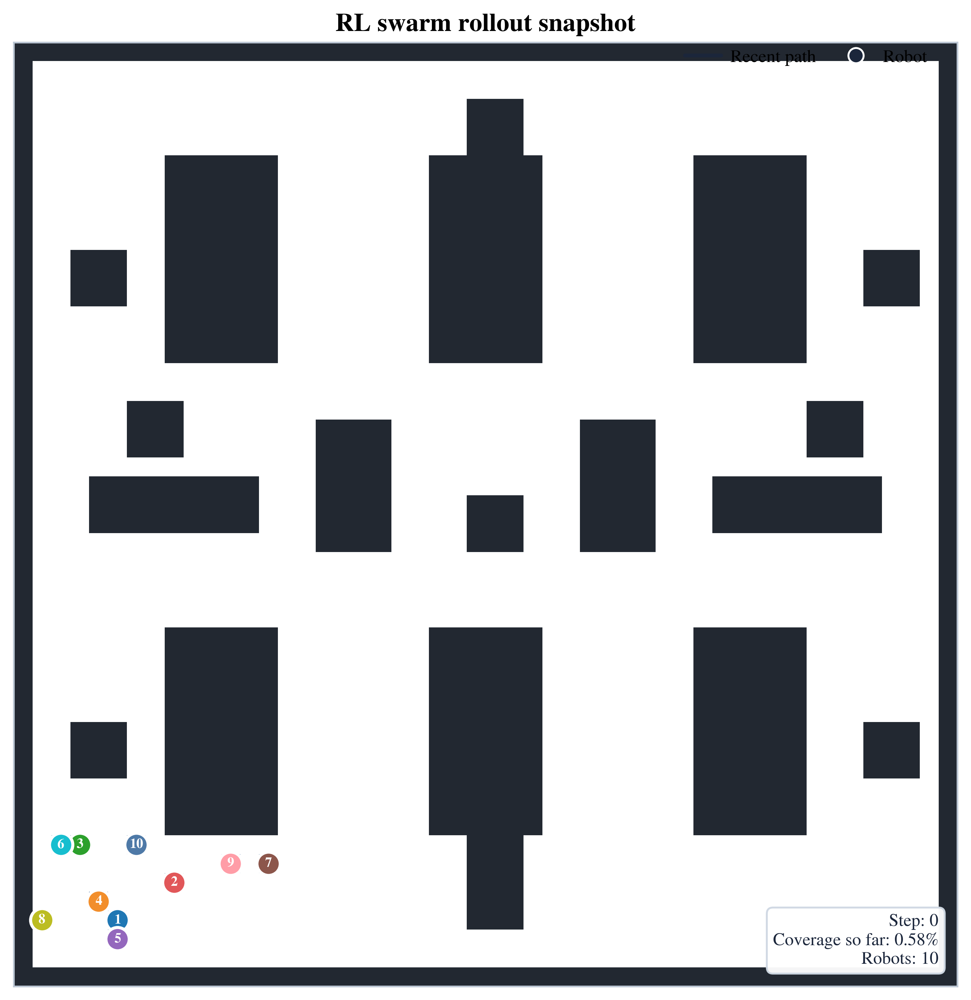 | 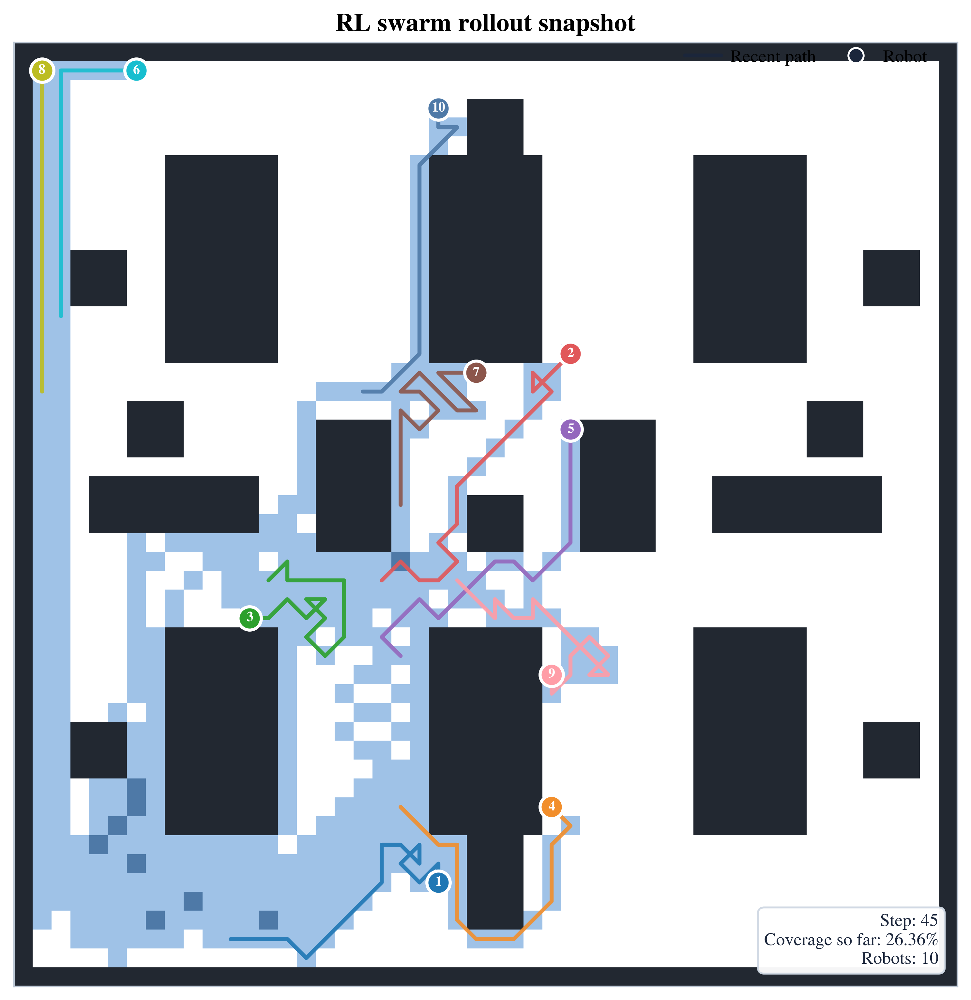 |

| Step 95 | Step 150 |
| --- | --- |
| 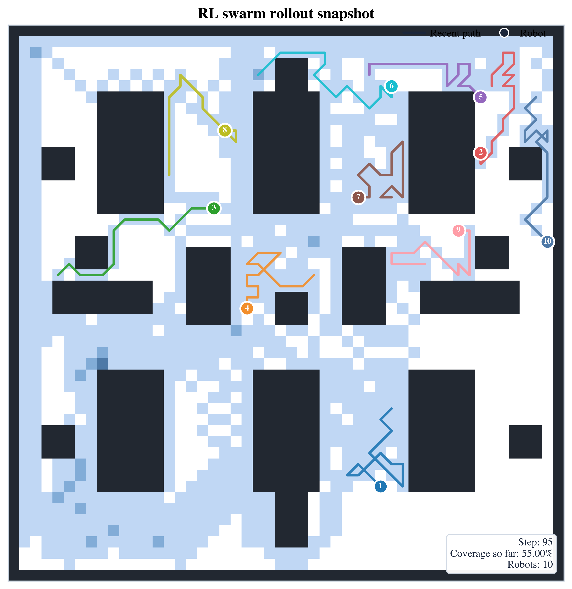 | 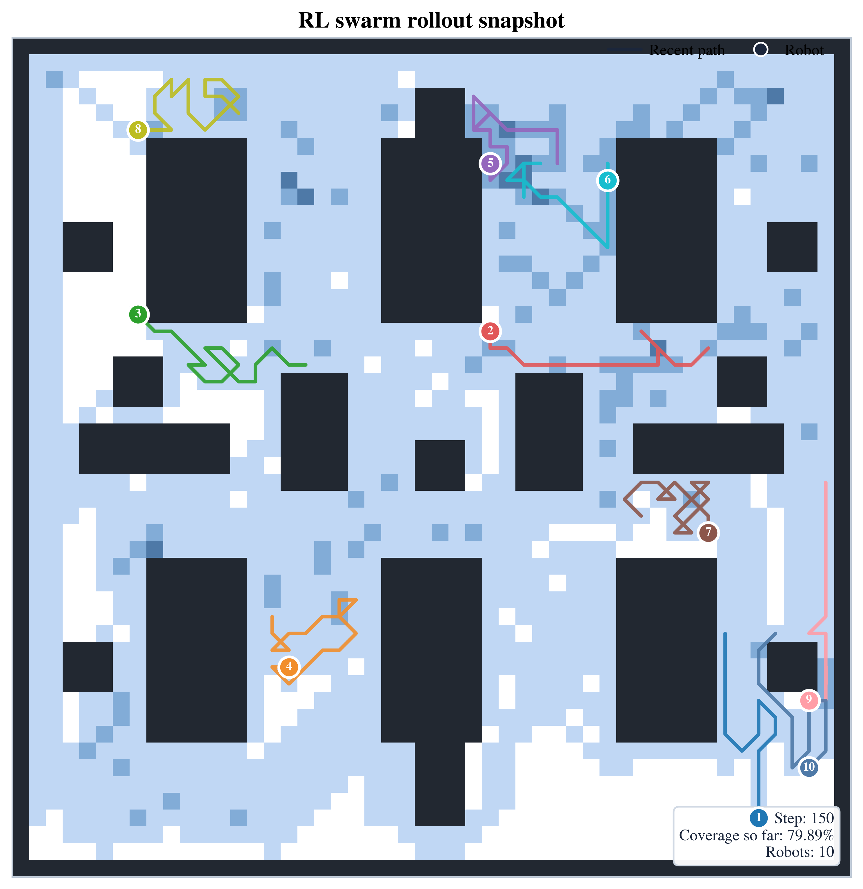 |

## Training plots

### Training reward

The reward curve tracks whether the shared policy is learning useful team-level behavior. The moving average is included because individual episodes can vary due to map interaction and exploration.

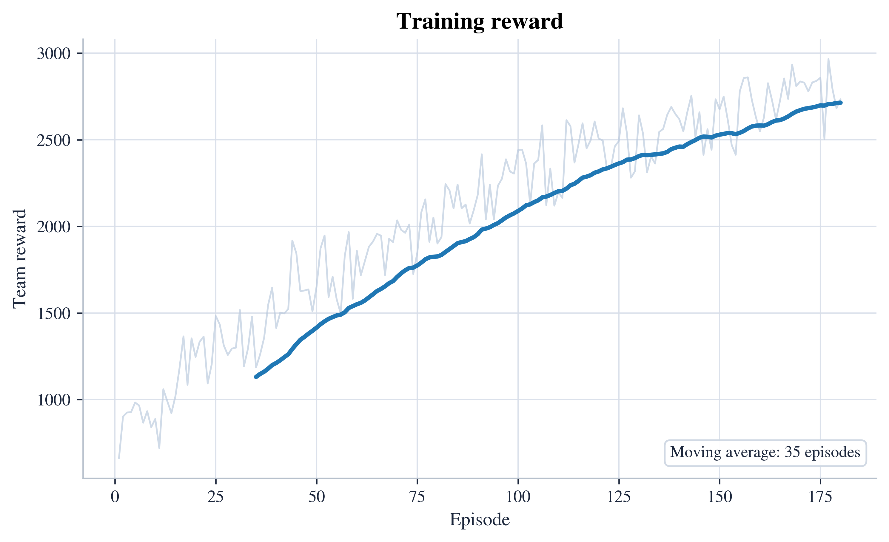

### Training coverage

This plot shows the final coverage reached during training episodes.

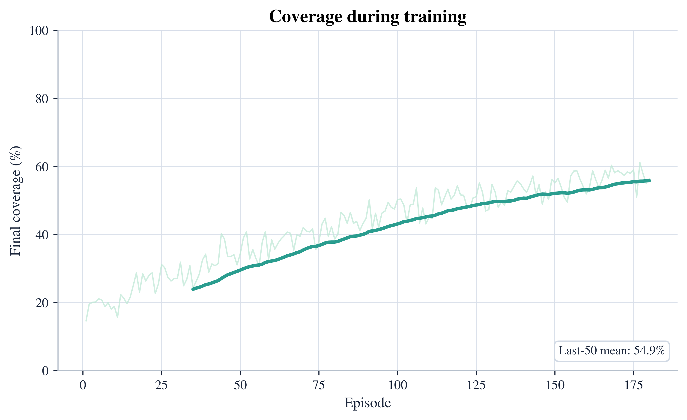

### Training collisions

The collision curve checks whether the policy is becoming safer over time. The final evaluated RL rollout has zero collisions.

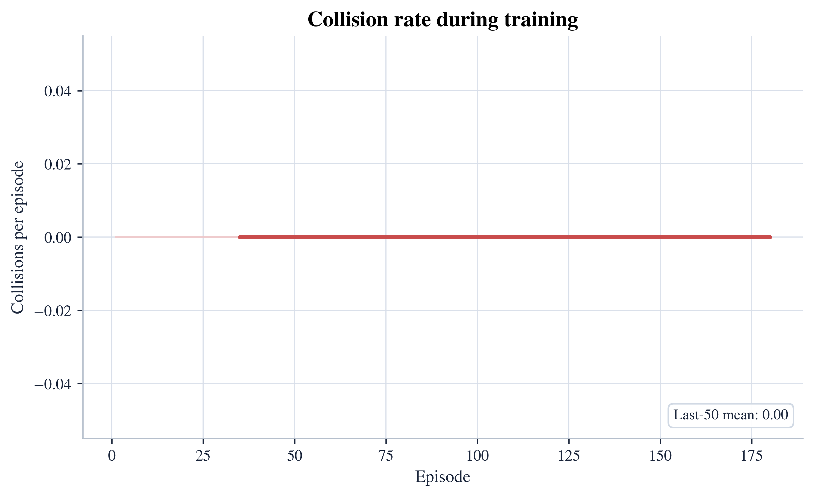

## Environment

The simulator is intentionally lightweight. It uses a grid world rather than a heavy physics engine, which makes the policy and evaluation easy to inspect.

| Setting | Value |
| --- | --- |
| Grid size | 50 x 50 |
| Number of robots | 10 |
| Episode horizon | 150 steps |
| Target coverage | 90% |
| Map type | Cluttered warehouse-like grid |
| Motion model | 8-direction grid motion plus hold |

The map contains shelf-like blocks, narrow corridors, small obstacles, and open regions. This makes the task more meaningful than simple open-space coverage because robots must split across passages and avoid wasting motion in already covered areas.

## RL formulation

### Agent structure

All robots use a shared Q-policy. Sharing the policy keeps the swarm scalable and avoids training a separate controller for each robot.

### Observation design

Each robot receives a compact local state based on:

- direction of nearby uncovered space
- local crowding from nearby robots
- current-cell visitation level
- obstacle pressure in the local neighbourhood
- proximity to the map boundary

The observation is deliberately small so the learned policy remains interpretable.

### Action space

Each robot chooses one of nine actions:

- north
- north-east
- east
- south-east
- south
- south-west
- west
- north-west
- hold

### Reward design

The reward encourages the swarm to:

- discover new free cells
- avoid collisions
- avoid repeatedly revisiting the same area
- maintain useful robot separation
- keep making team-level coverage progress

The controller also uses a one-step safety filter at evaluation time. If a proposed move would hit an obstacle, leave the map, or collide with another robot, it is rejected.

## Controllers compared

### RL swarm

A shared tabular Q-learning controller with a coordination-aware rollout decoder. It combines learned Q-values with local novelty and light role spreading so that robots do not simply shadow each other.

### Greedy Coverage Algorithm

A deterministic local planner that moves each robot toward nearby uncovered cells. This is a reasonable hand-written baseline because it has direct access to local coverage structure, but it does not learn longer-horizon coordination patterns.

### Random walk

An uncoordinated controller that samples movement actions randomly. It is included as a lower-bound sanity check.

## Repository layout

```text
RL_based_Robotic_swarm_coordination/
├── README.md
├── PROJECT_REPORT.md
├── requirements.txt
├── scripts/
│   └── run_experiment.py
├── src/
│   └── swarm_rl/
│       ├── __init__.py
│       ├── env.py
│       ├── evaluation.py
│       ├── experiment.py
│       ├── training.py
│       └── visuals.py
└── results/
    ├── summary.json
    ├── training_history.npz
    ├── figures/
    │   ├── policy_comparison_coverage.png
    │   ├── final_coverage_bars.png
    │   ├── controller_collision_bars.png
    │   ├── learned_trajectory_map.png
    │   ├── learned_coverage_heatmap.png
    │   ├── robot_spacing_over_time.png
    │   ├── training_reward_curve.png
    │   ├── training_coverage_curve.png
    │   ├── training_collision_curve.png
    │   ├── snapshot_step_000.png
    │   ├── snapshot_step_045.png
    │   ├── snapshot_step_095.png
    │   └── snapshot_step_150.png
    ├── models/
    │   └── shared_q_policy.npy
    └── rollouts/
        ├── learned_rollout.npz
        ├── greedy_rollout.npz
        └── random_rollout.npz
```

## How to run

Create a virtual environment and install the dependencies:

```bash
python -m venv .venv
source .venv/bin/activate
pip install -r requirements.txt
```

Run the full experiment:

```bash
python scripts/run_experiment.py --episodes 180 --seed 17
```

This will train the shared Q-policy, evaluate all controllers, save the model, save rollout data, regenerate the figures, and update `results/summary.json`.

